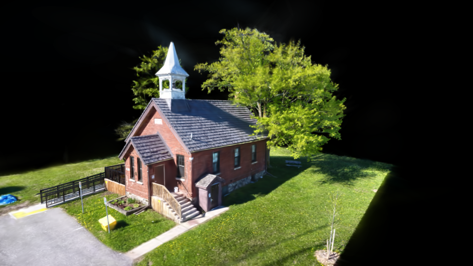

# Gaussian Splat Renderer

A real-time renderer for [3D Gaussian Splatting](https://repo-hyper.inria.fr/fungraph/3d-gaussian-splatting/)
scenes, written from scratch in C++20 with **Vulkan 1.3**, plus a **WebGPU** port that runs in the
browser (C++ compiled to WebAssembly, hand-written WGSL).

It was built step by step as a study project: every optimization is a separate, switchable code path,
measured with GPU timestamps and checked against a CPU port of the INRIA reference rasterizer, so the
cost and the effect on the image of each idea can be compared directly.

**Live web demo: <https://netolcc06.github.io/gsplat-web/>** (needs a WebGPU browser, e.g. Chrome or Edge)



<sub>"Knock Community Hall" by [scbenoit](https://superspl.at/user?id=scbenoit), CC BY 4.0, decimated to
300k gaussians. See [data/demo/knock-community-hall/ATTRIBUTION.txt](data/demo/knock-community-hall/ATTRIBUTION.txt).</sub>

## Highlights

- **Standard 3DGS `.ply` scenes** (INRIA format, SH degree 0-3), streaming loader, training cameras from
  `cameras.json`, scenes opened at run time (file dialog, drag and drop) while the old one keeps rendering.
- **Four renderers**, switchable with `--renderer`:
  - `splat`: compute preprocess (3D covariance, EWA projection, SH colour) + CPU depth sort + instanced quads.
  - `splat-gpusort`: GPU culling, stream compaction, GPU radix sort and indirect draw.
  - `splat-tiles` (default): a compute **tile rasterizer** in the style of the INRIA CUDA renderer, with
    tile binning, per-tile ranges, shared-memory batches and early termination by transmittance.
  - `points`: a debug point cloud.
- **GPU building blocks** written for this project: LSD radix sort (classic and local-reorder scatter),
  reduce-then-scan prefix sum, order-preserving compaction, all GPU-driven with indirect dispatch.
- **Tight, exact tile bounds**: INRIA's 3-sigma rectangle clipped to the `alpha >= 1/255` ellipse, computed
  row by row. It produces the identical image with about 67% fewer tile entries.
- **Compression and memory**: fp16 and 8-bit scene formats, a k-means SH codebook (AVX2), SoA/AoS layouts,
  packed per-entry records, an adaptive tile list and a per-buffer GPU memory report.
- **Quality options**: per-gaussian SH degree, and a StopThePop-style per-pixel sort window against popping.
- **Verification**: a CPU reference renderer (`gsplat_ref`), an image diff tool (`imgdiff`), CTest suites,
  Vulkan validation including synchronization validation, and screenshot/benchmark automation.

## Performance

1920x1080, 300-frame 360-degree orbit, RTX 4060 Laptop GPU. "GPU frame" is the timestamp of the whole
frame. PSNR is measured against the CPU reference; 58.9 dB is the floor imposed by 8-bit output.

| configuration | train (559k gaussians) | bonsai (1.24M gaussians) |
|---|---|---|
| `splat`: CPU sort + instanced quads (baseline) | 20.26 ms | 14.67 ms |
| `splat-gpusort`: GPU cull + radix sort + indirect draw | 20.37 ms | 13.76 ms |
| `splat-tiles`: compute tile rasterizer | 9.45 ms | 7.72 ms |
| `splat-tiles` + tight bounds + adaptive list (**default**) | **4.26 ms** (4.8x) | **4.03 ms** (3.6x) |
| default + fp16 scene + per-gaussian SH | 4.06 ms | 3.89 ms |

The default configuration produces the same image as the INRIA forward pass, up to the 8-bit floor
(58.77 dB on both scenes).

On the same GPU the WebGPU version reaches 5.4 ms (train) and 5.0 ms (bonsai) and produces the same
image as the native build (at most 1/255 apart). Most of the gap comes from its portable 4-bit radix sort.

> On laptops with two GPUs, Chrome on Windows ignores the page's high-performance request and uses
> whichever GPU Windows assigns to the browser. To use the discrete GPU, open
> *Settings > System > Display > Graphics*, set Chrome to *High performance* and restart Chrome.

## Requirements

**Native (Vulkan)**

- Windows 10/11, Visual Studio 2022 (MSVC 14.4x), CMake >= 3.24
- [Vulkan SDK](https://vulkan.lunarg.com/) 1.4.x, which provides the headers, `glslc` and the validation layer
- A GPU with Vulkan 1.3 (dynamic rendering, synchronization2, timeline semaphores, buffer device address).
  A discrete GPU is preferred automatically.

GLFW, GLM, Dear ImGui, VMA, nlohmann/json and stb are fetched by CMake `FetchContent` at pinned versions
on the first configure, so the first configure needs network access.

**Web (optional)**

- [Emscripten](https://emscripten.org/) 6.0.x (emsdk; the build uses the `emdawnwebgpu` port), Ninja
- A browser with WebGPU. Subgroup shader variants are used when the device supports them, with portable
  fallbacks otherwise.

## Build

```powershell
# Native
cmake --preset native                       # = cmake -S . -B build -G "Visual Studio 17 2022" -A x64
cmake --build --preset native-release       # -> build/bin/Release/gsplat.exe
cmake --build --preset native-debug         # Debug: validation layer always on

# Web -> build-web/dist/ (activates emsdk for this process, then runs the "web" preset)
powershell -ExecutionPolicy Bypass -File tools/web/build_web.ps1 -Emsdk C:\path\to\emsdk
node tools/web/serve.mjs                    # serve build-web/dist locally
```

GLSL shaders (`shaders/`) are compiled to SPIR-V during the build. WGSL shaders (`shaders/wgsl/`) are
embedded into the wasm module.

## Getting scenes

Any standard 3DGS `.ply` works, for example the INRIA pretrained models (`point_cloud.ply`, with
`cameras.json` next to it). Scene files are not part of this repository.
[data/README.md](data/README.md) lists the scenes used for testing, where to download them and their
licenses. INRIA models are for non-commercial research use only.

```powershell
python -I tools/gen_synthetic_ply.py --all   # small synthetic scenes used by the tests -> data/synthetic/
python -I tools/ply_info.py scene.ply        # inspect a .ply header and statistics
```

## Run

```powershell
# Interactive (scenes can also be opened from the UI: "Open scene...", Ctrl+O, drag and drop)
build\bin\Release\gsplat.exe --scene path\to\point_cloud.ply

# Start from training camera 0 of the cameras.json next to the scene
build\bin\Release\gsplat.exe --scene path\to\point_cloud.ply --camera-index 0

# Compare renderers and options
build\bin\Release\gsplat.exe --scene scene.ply --renderer splat-gpusort
build\bin\Release\gsplat.exe --scene scene.ply --scene-format q8 --sh-threshold 0.25

# Automation: screenshot, or a 300-frame benchmark written as JSON
build\bin\Release\gsplat.exe --scene scene.ply --camera-index 0 --width 1920 --height 1080 --screenshot out.png
build\bin\Release\gsplat.exe --scene scene.ply --camera-index 0 --width 1920 --height 1080 --benchmark bench.json
```

`gsplat --help` lists every option. Exit codes: `0` success, `1` runtime error, `2` bad command line,
`3` an automated run finished but the validation layer reported errors or warnings.

**Controls**: `Tab` toggles orbit and fly mode, and `R` resets the camera. In orbit mode the left button
rotates, the right or middle button pans and the wheel zooms. In fly mode a mouse button looks around,
`WASD` moves, `Q`/`E` move down and up, `Shift` moves faster and the wheel changes the speed. The ImGui
panel shows per-pass GPU timings, scene statistics and GPU memory, and switches renderers and options
live.

**Camera files** (`--camera cam.json`, or "Save camera.json" in the UI):

```json
{ "mode": "orbit", "position": [2.0, 1.6, 2.4], "target": [0.0, 0.0, 0.0], "fov_y_deg": 60.0 }
```

World space is right-handed with +Y up. Use `--up` to choose which scene axis points up (default: the
training cameras' mean up, or -Y for COLMAP scenes).

## Tests and verification

```powershell
ctest --test-dir build -C Release --output-on-failure

# GPU vs the CPU reference renderer on synthetic and real scenes (PSNR table, fails below threshold)
powershell -ExecutionPolicy Bypass -File tools/run_reference_checks.ps1 -Renderer splat-tiles

# Single comparison
build\bin\Release\gsplat_ref.exe --scene scene.ply --camera-index 0 --width 960 --height 540 --pfm ref.pfm
build\bin\Release\gsplat.exe     --scene scene.ply --camera-index 0 --width 960 --height 540 --screenshot gpu.png
build\bin\Release\imgdiff.exe gpu.png ref.pfm --heatmap diff.png --min-psnr 50

# Web: headless Chrome checks (scan/sort/coverage self-tests, images vs reference)
cd tools/web; npm ci; node run_web_checks.mjs --test w2
```

The CTest suites cover the PLY loader and its error paths, the splatting math (EWA projection checked
against a numerical Jacobian, SH, tile bounds), the GPU radix sort (bit-exact against the CPU sort), the
tile rasterizer, the compressed scene formats and the exact tight bounds.

## Repository layout

```
src/core/      Vulkan context, swapchain, resources, descriptors, pipelines, GPU profiler, memory report
src/scene/     PLY loader, scene data and GPU formats, compression (fp16, q8, k-means codebook), transforms
src/splat/     splatting math, CPU sort, tile coverage, CPU reference renderer (no Vulkan)
src/render/    renderers (splat, splat-gpusort, splat-tiles, points), GPU radix sort and prefix scan
src/app/       window and frame loop, camera, CLI, ImGui UI, runtime scene loading
src/webgpu/    WebGPU backend: context, scene upload, scan, radix sort, tile renderer, self-tests
src/web/       Emscripten entry point and the JS-facing API
shaders/       GLSL (native) and shaders/wgsl/ (web)
web/           the web page (HTML/CSS/JS)
tools/         reference renderer, image diff, benchmarks, scene tools, web build and checks
tests/         CTest executables
data/          scene notes and the demo scene's attribution (scenes themselves are not committed)
```

Some source comments refer to `docs/notes/...`. Those are the project's internal engineering notes and
are not published in this repository.

## Acknowledgements

- Kerbl, Kopanas, Leimkühler, Drettakis, *3D Gaussian Splatting for Real-Time Radiance Field Rendering*,
  SIGGRAPH 2023. The math and the reference semantics follow the
  [INRIA implementation](https://github.com/graphdeco-inria/gaussian-splatting). No INRIA code is included.
- Radl et al., *StopThePop: Sorted Gaussian Splatting for View-Consistent Real-time Rendering*, SIGGRAPH 2024.
- [GLFW](https://www.glfw.org/), [GLM](https://github.com/g-truc/glm), [Dear ImGui](https://github.com/ocornut/imgui),
  [Vulkan Memory Allocator](https://github.com/GPUOpen-LibrariesAndSDKs/VulkanMemoryAllocator),
  [nlohmann/json](https://github.com/nlohmann/json), [stb](https://github.com/nothings/stb),
  [Emscripten](https://emscripten.org/) and [Dawn](https://dawn.googlesource.com/dawn).

## License

The code is released under the [MIT License](LICENSE). Third-party libraries and scenes keep their own
licenses.
